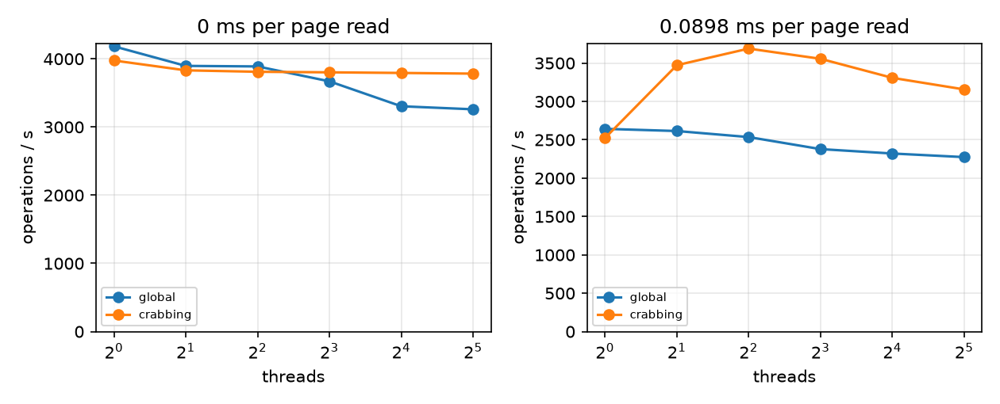

# Benchmark results and findings

Measured results for the four research questions. Every run in this folder
checks every index result against the sequential scan: **all results match,
in every run, before and after inserts.** Page I/O is counted by the storage
layer on a cold 256-page (1 MB) buffer pool; I/O cost is
`sequential reads + k × random reads`.

**`k` is measured, not assumed.** `default/`, `1m/` and `concurrency/` use
the `k` measured on the test machine by `python3 -m dbmsi.bench calibrate`
(`benchmarks/calibration.json`): a random 4 KB read takes 90 µs and a
sequential one 29 µs, so **k = 3.08**. The concurrency runs use the measured
90 µs as the modeled read latency. The earlier results assumed k = 1, 4, 10
and read latencies of 0.1–2 ms; see "Measured I/O cost" in the main README.
`scale/`, `cardinality/` and `smoke/` were not re-run and still report the
assumed k = 1, 4, 10 (their page read counts do not depend on `k`).

| folder | what it is | config |
|---|---|---|
| `1m/` | every method and query type, 1,000,000 files | `benchmarks/default.json --set num_files=1000000 --set name=1m` |
| `default/` | the same at 100,000 files | `benchmarks/default.json` |
| `scale/` | 10K → 100K → 1M files (`sweep.md`) | `sweep benchmarks/scale.json --param num_files` |
| `cardinality/` | bitmap encodings vs. number of distinct uids (`sweep.md`) | `sweep benchmarks/cardinality.json --param generator.num_users` |
| `concurrency/` | B+ tree latching, 1M files, 0 and 0.09 ms (measured) read latency, 1–32 threads | `benchmarks/concurrency.json` |
| `smoke/` | 3,000-file sanity run | `benchmarks/smoke.json` |

Each run folder has `report.md` (all tables), CSVs, `results.json` (config,
environment, git commit) and figures. Runs used Python 3.15.2 on an Apple
silicon Mac (`scale/`, `cardinality/` and `smoke/`: Python 3.13.9, commit
`e08b05d`). Page I/O is deterministic for a given config; latencies vary
between machines and runs.

## Correctness and the cost model (success criteria)

- `1m/`: 625 of 625 query results match the scan; after 200 inserts, 425
  results re-checked, 0 mismatches. Same in `default/`, `scale/`,
  `cardinality/`.
- **Analytical page-read estimates:** at 1M rows the total is 10,735,311
  measured vs 10,733,545 estimated (+0.0%). Every method/spec total is within
  0.2%, and **100% of single queries are within 5%** of their estimate. In
  the scale sweep every method is within 1.1% at every size
  (`scale/sweep.md`, `1m/estimates.png`).

## RQ1: when does an index beat the scan? (`1m/`, `scale/`)

At 1M rows the scan always reads 25,109 heap pages. A B+ tree range query on
`mtime` (matches scattered across the heap, so each fetch is a random read):

| selectivity | B+ tree page reads | B+ tree cost (k = 3.08) | scan cost |
|---|---|---|---|
| 0.01% | 103 | 314 | 25,111 |
| 0.1% | 989 | 2,964 | 25,111 |
| 1% | 8,326 | 19,869 | 25,111 |
| 10% | 25,065 | 25,869 | 25,111 |

- **Crossover:** by raw page reads the index stops winning at about **10%**
  selectivity. With the measured k = 3.08 the index is still 21% cheaper
  than the scan at 1% and 3% more expensive at 10%, so the crossover is
  just under **10%**. With the earlier assumed weights it was at about 1%
  (k = 4) and 0.4% (k = 10). A random read on this SSD costs about 3× a
  sequential one, much less than the assumed 4–10×, so the index pays off
  up to a higher selectivity here; on a spinning disk (larger k) the
  crossover would be lower.
- Point lookups are cheap: a `size` point query reads about 90 pages at 1M
  rows, vs 12 at 100K and 3 at 10K (`scale/sweep.md`): the cost grows with
  the matches, not the table.
- Bitmaps on `extension`/`category` read ~15% more pages than the B+ tree at
  1% selectivity (bitmap pages plus the RID directory), and both pass the
  scan's page count at ~10% selectivity, the same crossover.
- Wall-clock latency is lower for indexes even near the crossover (e.g. 290
  ms vs 1,096 ms at 10%) because the scan decodes and tests every record in
  Python; compare on page I/O first.

## RQ2: bitmap encodings vs. cardinality (`cardinality/`, 100K rows)

| distinct uids | 10 | 100 | 1,000 | 5,000 |
|---|---|---|---|---|
| uncompressed | 0.71 MB | 1.77 MB | 11.53 MB | 24.50 MB |
| WAH | 0.70 MB | 0.81 MB | 0.85 MB | 0.87 MB |
| Roaring | 0.68 MB | 0.71 MB | 0.73 MB | 0.74 MB |

- Uncompressed size grows linearly with cardinality (one full-length bitmap
  per value); **WAH and Roaring stay almost flat** (28× and 33× smaller at
  5,000 values). Roaring is the smallest at every cardinality.
- Page reads per query are nearly identical across encodings (they are
  dominated by RID-directory pages); at 0.01% selectivity and 1,000+
  distinct values, WAH and Roaring read about 20% fewer pages than
  uncompressed.
- At 1M rows (`1m/`) on `extension`/`category`: uncompressed 10.4 MB, WAH
  9.6 MB, Roaring 8.3 MB.
- Inserts: Roaring touches the fewest pages per insert at 1M (24 vs 37
  uncompressed, 33 WAH).

## RQ3: posting-list compression (`1m/`, `default/`)

| at 1M rows | delta + variable-byte | uncompressed |
|---|---|---|
| postings size | 7.90 MB | 24.31 MB (**−67%**) |
| index pages read, `term` at 1% / 10% | 7.4 / 37.4 | 20.6 / 193.8 |
| index pages read, `and` at 1% | 85 | 480 |
| decode time, `term` at 10% | 44 ms | 37 ms (+18%) |

- Compression saves two thirds of the storage and reads **3–6× fewer index
  pages**, for about 20% more decode CPU.
- Once matching records are fetched, heap reads dominate (e.g. 8,240 total
  reads at 1% for both), so the end-to-end difference is small; compression
  matters most for index-only (count / AND) queries.
- Delta + Gamma coding is not implemented, so it is not compared.

## RQ4: B+ tree concurrency, global latch vs. latch crabbing (`concurrency/`)

20,000 operations (20% inserts) on a 1M-entry `size` tree, cold 256-page
pool, 1–32 threads. The modeled read latency is the **measured** random read
time, 0.09 ms, next to 0 ms (pages in memory). **0 lost inserts in every
configuration.**

| read latency | threads | global latch (ops/s) | latch crabbing (ops/s) | crabbing / global |
|---|---|---|---|---|
| 0 ms | 1 | 4,183 | 3,975 | 0.95× |
| 0 ms | 32 | 3,260 | 3,783 | 1.16× |
| 0.09 ms | 1 | 2,643 | 2,523 | 0.95× |
| 0.09 ms | 2 | 2,614 | 3,473 | 1.33× |
| 0.09 ms | 8 | 2,379 | 3,556 | **1.49×** |
| 0.09 ms | 32 | 2,274 | 3,157 | 1.39× |

- **Global latch: adding threads never helps.** Throughput is flat or drops
  slightly with more threads, because a thread waiting on a page read holds
  the whole tree.
- **Latch crabbing helps once reads cost something**, but much less than
  the earlier assumed latencies suggested. At the measured 0.09 ms it is
  1.3–1.5× faster than the global latch from 2 threads up, peaking at 1.49×
  with 8 threads. The earlier runs assumed 0.5–2 ms per read (a slower
  disk) and reported up to 12× at 2 ms; **the speedup grows with read
  latency**, and a real SSD read is short.
- **It stops at the CPU ceiling:** about 3,500–3,700 ops/s. Python's GIL
  runs one thread's CPU work at a time, so once reads overlap, CPU is the
  limit; throughput peaks at 4 threads and then slowly falls. With no read
  latency (pages in memory) the two schemes are within 5% up to 8 threads,
  and crabbing is about 15% ahead at 16–32 threads.
- **Tradeoffs:** crabbing takes a latch on every node of the path, so with
  one thread it is about 5% slower than the global latch, and it is more
  complex (optimistic and pessimistic insert paths, latch ordering). It pays
  off only when several threads can overlap waits on page reads; for a
  single thread, or a tree that is fully in memory, the global latch is
  about as fast and much simpler.
- The same pattern holds in `default/` (100K rows: 1.9× at 0.09 ms, 4–16
  threads) and `1m/` (1.5–1.6×).
- *Read latency is modeled*: `DiskManager(read_latency=...)` waits that long
  per physical read, outside every lock, as a disk would. Page I/O counts
  are unchanged by it.
- Throughput runs are timing-based. They were repeated on an otherwise idle
  machine; an earlier run made while other processes were busy was
  discarded because its numbers were far lower.

## Not covered

- **W4** (`extension AND semester`): the data has no `semester`/`course`
  fields.
- **W6** (BM25 ranking, issue #10) and **Delta + Gamma** posting coding: not
  implemented.
- **10M rows** (issue #11): results stop at 1M. The whole dataset is held in
  Python objects, which would not fit in memory on the 16 GB test machine.
- Latency numbers measure this Python implementation on in-memory pages;
  conclusions are drawn from page I/O, and for RQ4 from relative throughput.
